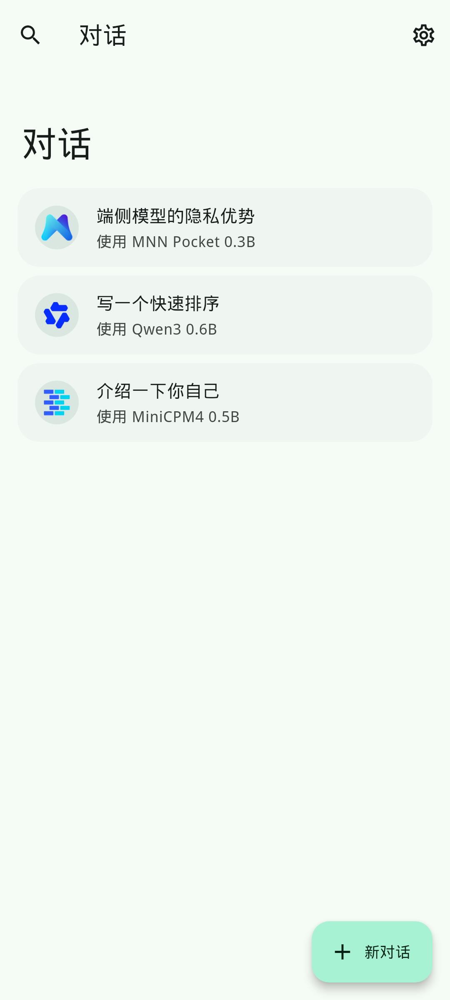
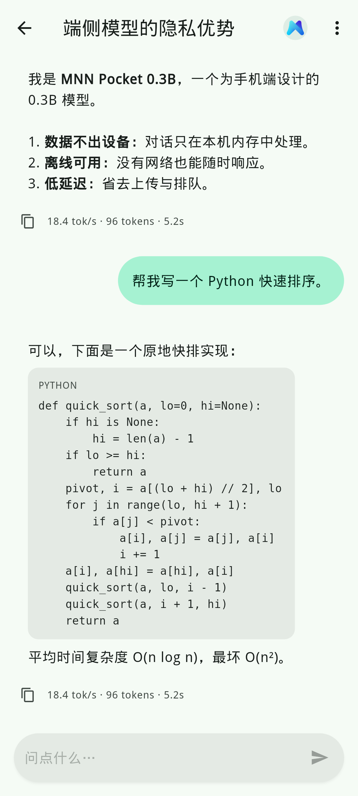
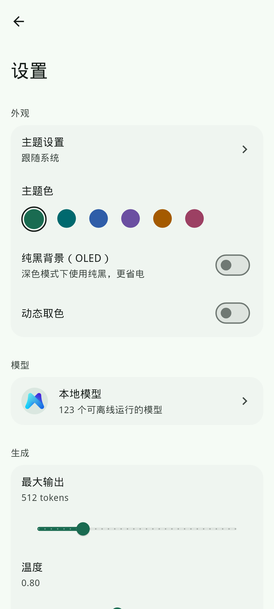
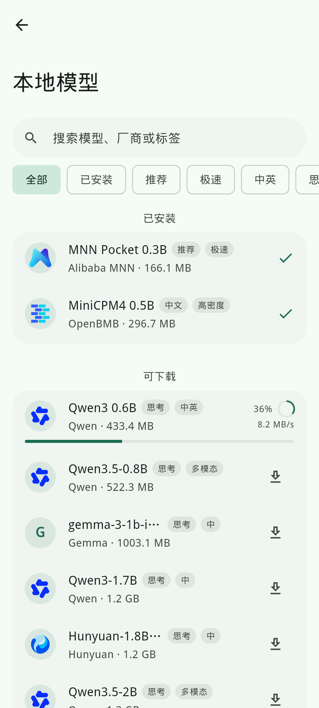
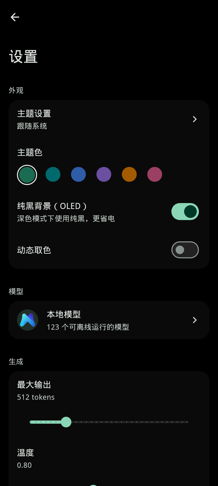
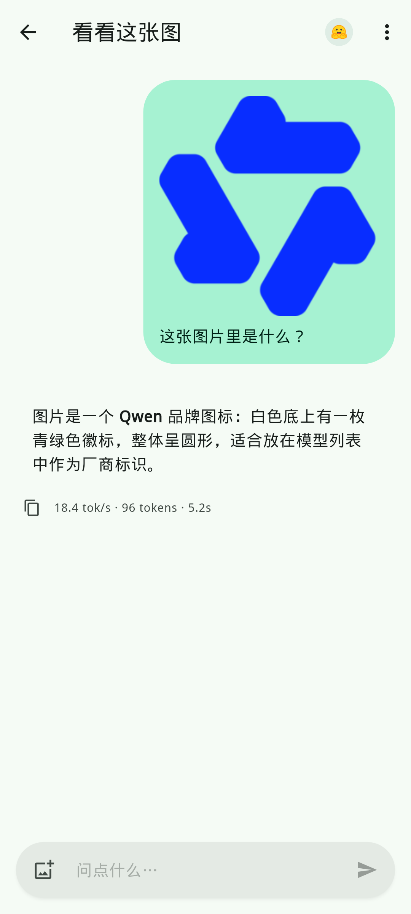

# Pocket Chat

**装进口袋的本地大模型聊天客户端。** 基于 MNN 运行时，模型与对话全部留在设备上，断网也能用。

Android 8.0+ · arm64-v8a · Flutter · Material 3

---

## 简介

Pocket Chat 是一个完全离线的 Android 聊天客户端。它把 MNN 的端侧推理能力包装成一套日常可用的聊天 App：下载模型、开口对话、切换主题，仅此而已。

没有账号，没有云端同步，没有「服务不可用」。推理在你的手机上完成。

## 功能

- **完全本地推理** —— MNN 3.6.2 + Kotlin/JNI，对话内容不出设备
- **125 个模型** —— 从 0.125B 到 35B，覆盖 Qwen、Gemma、Llama、DeepSeek、MiniCPM、Hunyuan、SmolLM 等 29 个厂商/系列，只要 MNN 架构能跑就收录
- **后台下载** —— 前台服务 + 常驻通知，锁屏或切到后台继续下载，进度实时可见
- **断点续传** —— 逐文件校验，中断后从已下载位置继续
- **图片多模态** —— 相册选图，交给视觉模型理解画面
- **流式输出** —— 逐字生成，可随时停止
- **实测速度** —— 每次回答后显示 prefill / decode 速度与 token 数
- **可调生成参数** —— 上下文条数、最大输出、temperature、top-p、top-k、线程数、CPU/OpenCL 后端
- **模型管理** —— 标签筛选、关键词搜索、已安装优先排序、长按删除
- **主题** —— 6 种预设主题色 / 动态取色 / 深色模式 / OLED 纯黑
- **厂商图标** —— 按模型名与厂商正则匹配品牌标识，未知模型回退首字母

## 界面

界面结构、圆角与配色参考 [Taewan-P/gpt_mobile](https://github.com/Taewan-P/gpt_mobile)，并按 Material 3 重新实现。默认主题色 `#1A6B51` 与原版一致。

| 对话列表 | 聊天 |
| :-: | :-: |
|  |  |

| 设置 | 本地模型 |
| :-: | :-: |
|  |  |

| OLED 纯黑 | 图片多模态 |
| :-: | :-: |
|  |  |

## 快速开始

1. 从 [Releases](https://github.com/wiwcn/pocket-chat/releases) 下载 `pocket-chat-v1.0.0-arm64-v8a.apk`
2. 安装并打开（需要 Android 8.0 或更高版本、arm64 设备）
3. 进入「本地模型」，推荐先下载 **MNN Pocket 0.3B**（166 MiB）
4. 下载完成后点击模型开始聊天

> 首次下载大模型时，系统会提示通知权限。允许后可在通知栏查看下载进度；拒绝不影响下载本身。

也可以从源码构建，见[从源码构建](#从源码构建)。

## 模型目录

目录收录 **125 个** MNN 可运行的对话与视觉模型，定义在 [`assets/models.json`](assets/models.json)。参数范围 0.125B–35B，体积范围 65 MiB–21 GiB。

筛选栏提供「已安装 / 推荐 / 思考 / 多模态 / 代码 / 数学 / 安全」等标签，搜索框支持模型名、厂商与标签。

### 推荐起步

| 模型 | 参数 | 体积 | 上下文 | 特点 |
| --- | --- | --- | --- | --- |
| MNN Pocket 0.3B | 0.3B | 166 MiB | 32K | 与 MNN 协同设计，手机端最快，默认首选 |
| Qwen3 0.6B | 0.6B | 433 MiB | 32K | 支持思考模式，中英均衡 |
| MiniCPM4 0.5B | 0.5B | 297 MiB | 32K | 中文高密度，短文本表现好 |
| Qwen3.5 0.8B | 0.8B | 522 MiB | 自适应 | 小体积多模态，可看图 |
| Gemma 3 1B | 1.0B | 1003 MiB | 自适应 | Google 小模型，英文稳定 |
| Gemma 4 E2B / E4B | 2B / 4B 有效 | 3.5 / 5.2 GiB | 32K | 新一代多模态，支持图像+音频输入 |
| Hunyuan 1.8B | 1.8B | 1189 MiB | 自适应 | 混合思考，中文流畅 |
| Qwen3.5 2B | 2.0B | 1322 MiB | 自适应 | 多模态，综合能力明显提升 |
| Qwen3 4B / 8B | 4B / 8B | 2.6 / 5.3 GiB | 自适应 | 复杂问答与代码 |
| Qwen3 14B–32B、gpt-oss-20b | 14B–32B | 9–19 GiB | 自适应 | 旗舰档，需大内存设备 |

> 2 GiB 以上的模型会在下载前弹出确认。端侧运行受内存与散热限制，大模型在手机上可能加载缓慢甚至失败，建议从 0.3B–2B 档开始。

### 模型来源

每个模型记录 ModelScope 仓库，并提供 HuggingFace 镜像回退。下载时先读取仓库文件清单，再逐文件下载与校验；只下载运行时真正需要的文件。

## 后台下载

下载任务运行在 `dataSync` 类型的前台服务中：

- 切到后台、锁屏或切换到其他应用，下载继续进行
- 通知栏显示聚合进度（单模型显示名称与百分比，多模型显示总数与总进度）
- 下载完成、取消或失败后，通知自动消失
- 应用进程被系统强制停止时任务会中断；再次下载时按已写入的分片继续（HTTP Range）

Android 13+ 需要 `POST_NOTIFICATIONS` 权限，App 会在首次下载时请求。未授权时下载仍可进行，只是没有通知。

## 图片多模态

当当前模型被标记为视觉模型（目录中共 32 个）时，输入框左侧会出现图片按钮：

1. 点击图片按钮，从相册选择一张图
2. 输入问题（可留空，默认「描述这张图片。」）
3. 发送后，MNN Omni 引擎在 tokenizer 阶段解码图片并运行视觉编码器

图片会被复制到应用私有目录，消息中以绝对路径引用，界面不展示原始路径。纯文本模型不会出现图片入口。

## 为什么特别推荐 Pocket 0.3B

原版 MNN Chat 的市场目录停留在 2026-05，没有收录 2026-11 发布的 Pocket 0.3B；同时普通用户没有界面内的模型导入入口。Pocket Chat 直接内置 125 个模型的目录，并对 Pocket 0.3B 使用其原生 `MNN/MNN-Pocket-0.3B-MNN` 仓库与 MNN 3.6.2 运行时，因此开箱即可下载、加载、对话。

## 架构

```
Flutter UI（Material 3）
  ├─ AppStore（ChangeNotifier）          lib/state/app_store.dart
  ├─ ModelDownloader（Range + 校验）      lib/services/model_downloader.dart
  ├─ BackgroundDownloads（前台服务）       lib/services/background_downloads.dart
  └─ MnnEngine（Method / EventChannel）    lib/services/mnn_engine.dart
        │
Android Kotlin 桥接                       android/.../MnnLlmBridge.kt
        │ JNI
MNN libllm（C++，3.6.2）                  android/app/src/main/cpp/mnn_llm_jni.cpp
        │
llm.mnn + llm.mnn.weight + tokenizer.mtok + llm_config.json
```

生成流程：`response(history, "<eop>", 0)` 完成 prefill，随后 `generate(1)` 逐 token 解码；支持中途停止，结束后同步 prompt cache。

## 从源码构建

依赖：

- Flutter 3.38（Dart 3.9+）
- JDK 17
- Android SDK 36、Build Tools 36.0.0
- NDK 28.2.13676358、CMake 3.22.1

```bash
flutter pub get
flutter analyze
flutter test
flutter build apk --release --target-platform android-arm64
```

产物：`build/app/outputs/flutter-apk/app-release.apk`

仓库已内置 MNN 3.6.2 的 arm64 运行库（`android/app/src/main/jniLibs/arm64-v8a/`）与头文件（`android/app/src/main/cpp/include/`），无需额外下载。

## 已知限制

- 仅支持 arm64-v8a 真机，x86_64 模拟器无法加载 MNN 运行库
- 视觉仅支持图片输入；音频、语音与视频输入未接入
- OpenCL 后端视设备驱动而定，默认 CPU；切换后端需重新加载模型
- 大模型（14B 以上）在手机上通常无法获得可用速度，更适合平板或大内存设备
- 应用被系统强制停止后，后台下载不会自动恢复，需要回到 App 重新发起

## 致谢与商标

- 界面参考：[Taewan-P/gpt_mobile](https://github.com/Taewan-P/gpt_mobile)
- 图标匹配思路参考：[Chevey339/kelivo](https://github.com/Chevey339/kelivo)
- 模型图标素材来自 LobeHub Icons（MIT）与各厂商公开渠道
- 推理运行时：[alibaba/MNN](https://github.com/alibaba/MNN)

各模型、厂商名称与标识归其各自所有者所有。本项目与阿里巴巴、MNN 团队及各模型厂商无隶属关系。
