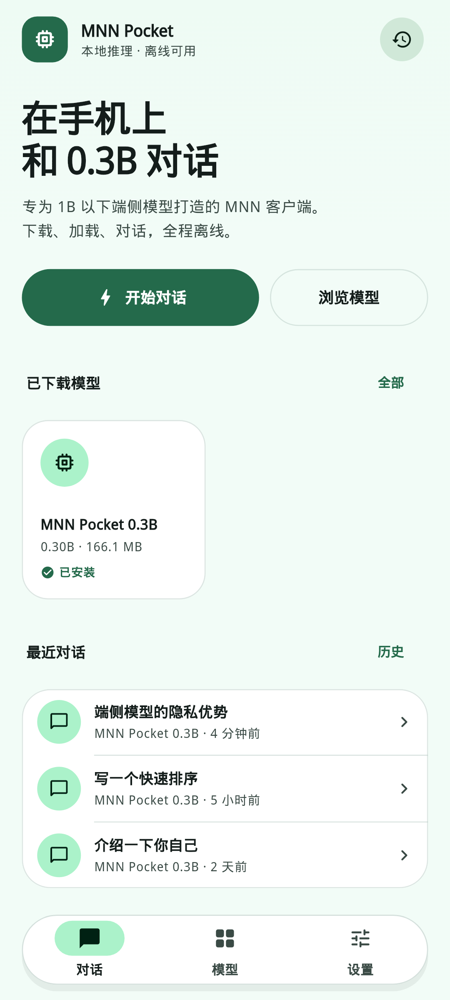
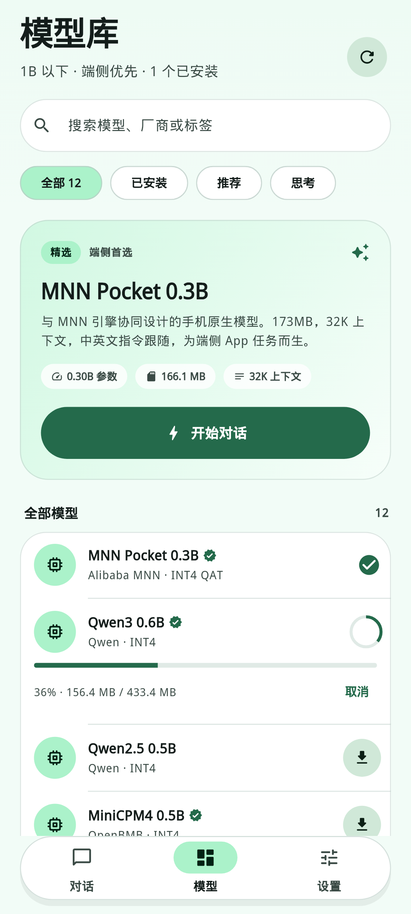
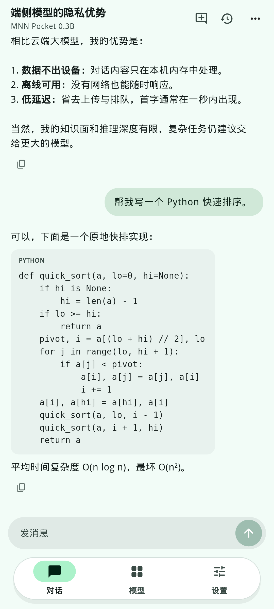
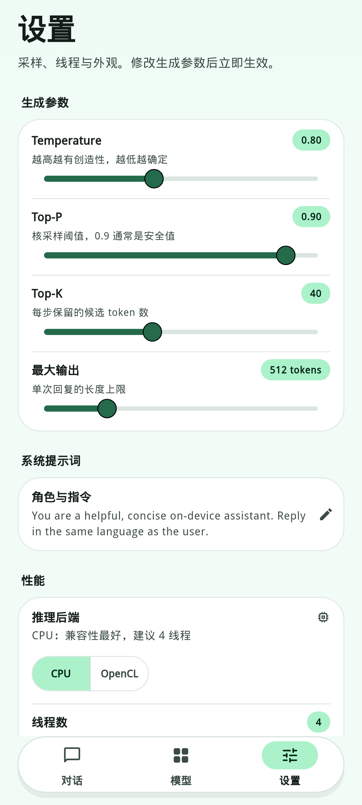
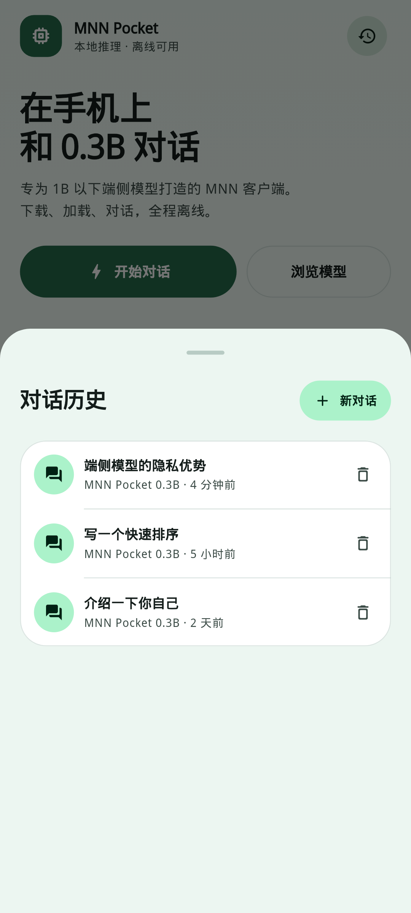

# MNN Pocket Chat

一个使用 **Flutter + Material 3 Expressive** 重写的 MNN Android 聊天客户端，专注 **1B 以下** 端侧模型，并把 `MNN-Pocket-0.3B` 作为一等公民支持。

- 完全本地推理：MNN 3.6.2 `libllm.so` + Kotlin/JNI
- 模型市场：ModelScope 优先，hf-mirror 自动回退
- 断点续传、逐文件校验、下载进度
- 流式输出、停止生成、思考过程折叠、tok/s 统计
- 动态取色、浅色/深色、可调 temperature / top-p / top-k / 线程数
- 仅 `arm64-v8a`，`minSdk 26`

## 界面

视觉参考 [Taewan-P/gpt_mobile](https://github.com/Taewan-P/gpt_mobile)，采用绿色 Material 3 Expressive 设计。

| 对话 | 模型库 | 聊天 |
| :-: | :-: | :-: |
|  |  |  |

| 设置 | 会话历史 |
| :-: | :-: |
|  |  |


## 为什么原版 MNN Chat 不支持 MNN-Pocket-0.3B？

结论：**不是模型本身不能跑，而是原版客户端的模型市场、导入入口和运行时版本三处都没有跟上。**

具体证据（仓库 `alibaba/MNN` master，2026-11）：

1. **模型市场没有收录**
   - `apps/Android/MnnLlmChat/app/src/main/assets/model_market.json` 为 v22，最后提交时间是 **2026-05-07**，其中没有 `MNN-Pocket-0.3B`。
   - 线上市场 `https://meta.alicdn.com/data/mnn/apis/model_market.json` 为 v21，同样没有。
   - Pocket 0.3B 于 **2026-11-04** 才发布，晚于这份目录半年。
   - 原版 App 的模型列表来自这份 JSON，因此 UI 里根本不会出现 Pocket。

2. **普通用户没有本地导入入口**
   - `LocalModelsProvider` 只扫描 `/data/local/tmp/mnn_models/`。
   - 该路径需要 adb/root 才能写入；App 内没有 SAF/文件选择器导入模型的流程。
   - 所以即使用户手动下载了 Pocket，也无法从界面添加。

3. **运行时版本必须匹配**
   - Pocket 的 `llm_config.json` 使用了 `tie_embeddings` 共享词嵌入，并带有 `weight_offset`、`alpha_offset`、`alpha_dtype: fp16`；分词器是 `tokenizer.mtok`。
   - 这些字段要求运行时的 MNN 版本与导出侧属于同一版本族。Pocket 模型卡明确提示：版本不匹配会报 `Load module failed`。
   - `tie_embeddings` / `alpha_dtype` 在 MNN **3.6.2**（2026-10-29）中已支持。旧版 APK 内置的 `libMNN.so` 不保证支持。
   - 因此本客户端直接内置 MNN **3.6.2** 的 Android `libllm.so` / `libMNN.so`。

4. **仓库选错也会失败**
   - `MNN/MNN-Pocket-0.3B` 是 HuggingFace safetensors 原始权重（约 723MB），不能直接被 MNN 运行时加载。
   - 可运行的是转换版 `MNN/MNN-Pocket-0.3B-MNN`（或 HF 上的 `taobao-mnn/MNN-Pocket-0.3B-MNN`），包含 `llm.mnn`、`llm.mnn.weight`、`tokenizer.mtok`、`config.json`、`llm_config.json`。
   - 本客户端的目录直接指向 `-MNN` 版本。

## 支持模型（≤ 1B）

| 模型 | 参数 | 体积 | 上下文 | 说明 |
| --- | --- | --- | --- | --- |
| MNN Pocket 0.3B | 0.3B | ~166 MiB | 32K | 推荐，MNN 原生设计 |
| Qwen3 0.6B | 0.6B | ~433 MiB | 32K | 支持思考模式 |
| Qwen2.5 0.5B | 0.5B | ~531 MiB | 32K | 稳定中文 |
| MiniCPM4 0.5B | 0.5B | ~297 MiB | 32K | 中文高密度 |
| Hunyuan 0.5B | 0.5B | ~383 MiB | 32K | 混合思考 |
| ERNIE 4.5 0.3B | 0.3B | ~269 MiB | 32K | 轻量底座 |
| SmolLM2 360M / 135M | 0.36B / 0.135B | ~311 / 138 MiB | 8K | 英文 |
| MobileLLM 125M / 350M / 600M | 0.125–0.6B | ~114–401 MiB | 4K | 英文 |
| Qwen2 0.5B | 0.5B | ~532 MiB | 32K | 兼容性验证充分 |

目录定义在 `assets/models.json`，新增模型只需添加一条记录；下载时会自动从 ModelScope/镜像获取文件清单。

## 架构

```
Flutter UI (Material 3 Expressive)
  ├─ AppStore (ChangeNotifier)          lib/state/app_store.dart
  ├─ ModelDownloader (resume + verify)  lib/services/model_downloader.dart
  └─ MnnEngine (Method/EventChannel)    lib/services/mnn_engine.dart
        │
Android Kotlin bridge                   android/.../MnnLlmBridge.kt
        │ JNI
MNN libllm (C++), MNN 3.6.2             android/app/src/main/cpp/mnn_llm_jni.cpp
        │
llm.mnn + llm.mnn.weight + tokenizer.mtok + llm_config.json
```

生成流程与官方 App 一致：`response(history, "<eop>", 0)` 仅做 prefill，然后 `generate(1)` 逐 token 解码，支持中途停止，结束后 `syncPromptCache`。

## 构建

依赖：

- Flutter 3.38（Dart 3.10）
- JDK 17
- Android SDK 36、Build Tools 36.0.0
- NDK 28.2.13676358、CMake 3.22.1

```bash
flutter pub get
flutter build apk --release --target-platform android-arm64
```

产物：`build/app/outputs/flutter-apk/app-release.apk`

本仓库已内置 MNN 3.6.2 的 `arm64-v8a` 运行库：

`android/app/src/main/jniLibs/arm64-v8a/`
`libllm.so`、`libMNN.so`、`libMNN_Express.so`、`libMNN_CL.so`、`libMNN_Vulkan.so`、`libMNNOpenCV.so`、`libMNNAudio.so`、`libmnncore.so`、`libc++_shared.so`

头文件位于 `android/app/src/main/cpp/include/`（MNN 3.6.2 tag）。

> 仅支持 arm64 真机；x86_64 模拟器不会加载这些库。

## 已知限制

- 只实现文本对话；视觉/音频/Omni 模型未接入。
- 下载在前台进行，切后台可能被系统冻结。
- OpenCL 后端视设备而定，默认 CPU；调用参数变化需重新加载模型。
- 0.3B–0.6B 模型适合短对话、改写、分类、抽取；复杂推理效果有限。
